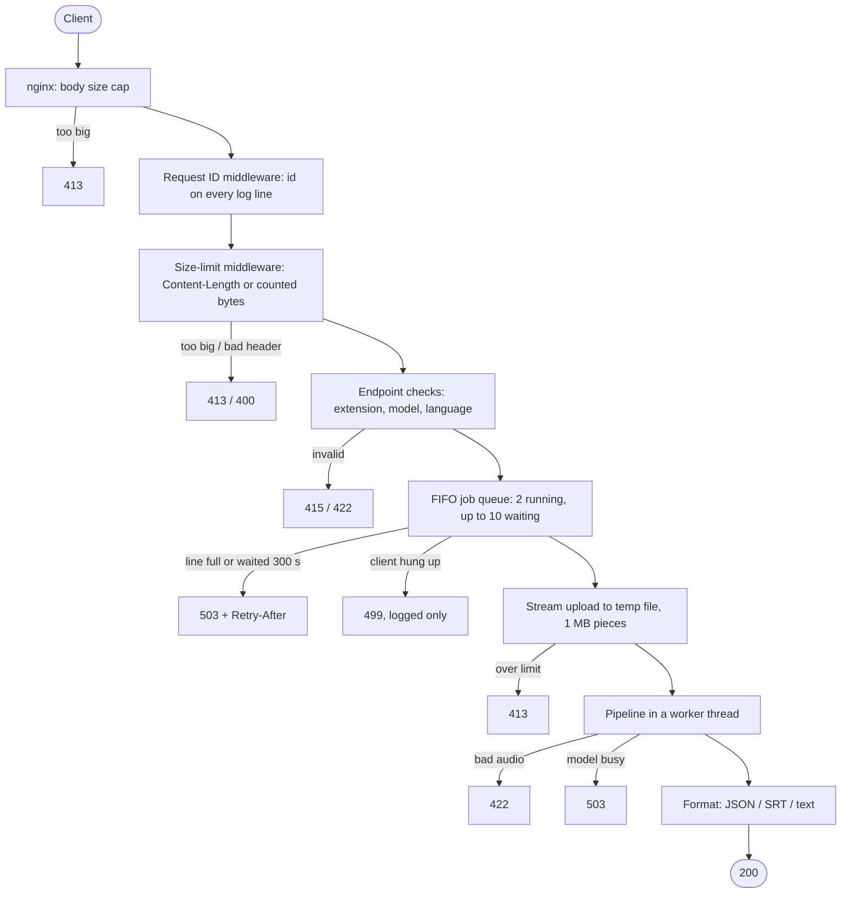
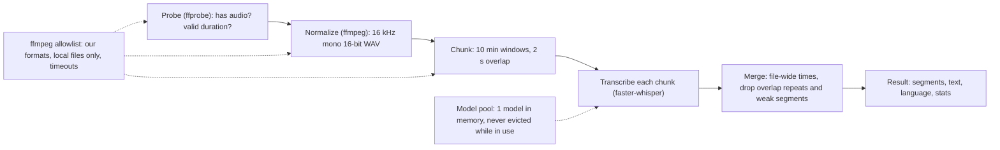

# Transcription Service: Design

Audio file in, transcript with per-segment timestamps out (JSON, SRT or plain text), through a CLI or an HTTP API.
This document explains the main decisions, the alternatives I rejected, what I measured, and what I would build next.

## 1. Scope

**Asked for:** accept an audio file, transcribe it with an open-source engine, return per-segment timestamps,
handle different formats and long files. The focus is engineering decisions, not model training.

**Built:** a single-node service that is safe to expose. It validates and bounds every input, queues work fairly,
never leaks temp files, logs one traceable line per job, and has measured performance.

**Deliberately not built (yet):** a distributed job system, authentication, speaker diarization, word-level
timestamps. Section 8 explains how each would fit; the seams for them already exist.

## 2. Architecture

### Request path: cheapest checks first, every exit has a status code

The temp file is created inside `try/finally`, so it is deleted on every exit after it exists. Every request ends with
exactly one `job finished` log line carrying its request id, status, timings and error.

### Pipeline: one file, start to finish

### Code layout

| Module | Responsibility |
|---|---|
| `transcriber/api.py` | HTTP endpoint and the wiring of the layers |
| `transcriber/observability.py` | request ids, text/JSON log formats, per-job summary line |
| `transcriber/limits.py` | request-size limit at the ASGI boundary |
| `transcriber/jobs.py` | FIFO job queue |
| `transcriber/pipeline.py` | the job for one file |
| `transcriber/media.py` | ffprobe/ffmpeg: validation, conversion, chunking |
| `transcriber/engine.py` | `SpeechModel` interface, allowed models, device choice, model pool |
| `transcriber/merge.py` | chunk times to file times, overlap de-duplication, confidence filter |
| `transcriber/result.py` | output types and SRT rendering |
| `transcriber/config.py` | all settings, read from the environment once and validated at startup |

## 3. Key decisions

| Decision | Alternatives considered | Why this one | Cost of the choice |
|---|---|---|---|
| **faster-whisper** (CTranslate2) | openai-whisper, whisper.cpp, hosted API | Open source; its maintainers report up to 4x faster than openai-whisper with comparable accuracy in their benchmarks; int8 on CPU; built-in VAD. | Python-only binding; GPU path needs CUDA libraries. |
| **Normalize everything with ffmpeg first** | Let the engine decode each format | One format downstream; chunking becomes an exact byte copy; format support is a list, not code. | One extra pass over the audio; ffmpeg parses untrusted input, so it needs the allowlists below. |
| **ffmpeg demuxer and protocol allowlists** | Trust the extension check | I reproduced a real attack: an upload named `.mp3` that is an HLS playlist made Debian's ffmpeg 5.1 read another file on the server. The allowlist turns it into a 422. | A new format needs its demuxer name added. |
| **Fixed 10-min chunks, 2 s overlap** | Whole file at once; cut at silences | Bounded memory (the engine loads its whole input as float32, about 230 MB per hour); predictable; simple. | A segment that straddles a cut can repeat a few words (measured, section 5). |
| **Segment-level overlap merge (midpoint rule)** | Word-level de-duplication | Works without word timestamps and keeps the output strictly ordered. | Occasional repeated words at a cut. Word-level is the next step. |
| **Model pool with a hard limit** | `functools.lru_cache` | An LRU cache can evict a model that a running request still holds, so two models sit in memory at once. The pool never evicts an in-use model and makes the caller wait, then 503. | About 80 lines of concurrency code, covered by tests that count live models. |
| **Synchronous API + in-process FIFO queue** | Celery/RQ/SQS job system now | No broker to operate for a single-node service. A burst of 20 went from 1.03 jobs/s (fail fast, clients retry) to 2.12 jobs/s with no retries. `JobQueue.slot()` is the one seam to replace. | Queue is per process and lost on restart; long files hold a connection open (section 7). |
| **Own size-limit middleware** in addition to nginx | nginx only; Starlette middleware | nginx is the first line. The app must also be safe when run without it, and the limit has to apply before the framework spools a multipart upload to disk, which Starlette's `BaseHTTPMiddleware` cannot do. | About 60 lines; the "response already started" edge case is documented and tested. |
| **Error taxonomy**: only `InvalidInputError` maps to 422 | Catch `ValueError` | A `ValueError` from a bug or a library must be a 500, not blamed on the client. | Code that rejects input must raise the specific type. |
| **stdlib logging + ContextVar request ids** | structlog | No extra dependency; the id follows the request into the worker thread; JSON output for log tools. | A little formatter code. |
| **Settings object validated at startup** | `os.environ` reads scattered across modules | One place to see every knob; a bad value stops startup with a clear message, not a mid-request crash. | None worth noting. |

## 4. Failure handling

| Situation | What happens |
|---|---|
| Fake or corrupt file, video without sound | 422 with a short message; full ffmpeg output logged server-side only |
| ffmpeg hangs on a crafted file | Process killed after its time limit (30 s probe; 60 s + 0.5 s per audio second to convert); 422 |
| Upload over the limit, with or without Content-Length | 413 from nginx, the middleware or the endpoint, whichever sees it first |
| Burst of requests | First 2 run, next 10 wait in arrival order, the rest get 503 + Retry-After at once |
| Client gives up while waiting | Leaves the line within about a second; never transcribed; logged as 499 |
| A different model is requested while the current one is busy | Waits up to 5 minutes for it to become idle, then 503; memory never holds two models |
| Bug anywhere | 500, temp files still deleted, error logged with the request id |

## 5. Measurements

Apple M3 Pro (11 cores), CPU only, int8. Reproduce with `tools/loadtest.py`.

| What | Result |
|---|---|
| `small` model (default), 80 s of speech | 52 s, real-time factor 0.65 (about 1.5x real time), about 1.2 GB RSS |
| `tiny` model | about 6x real time per worker |
| 1 worker running 1, 2, 4 or 8 jobs at once (`tiny`, 80 s file) | throughput flat (5.2x to 6.2x real time); median latency 14 s to 103 s; peak RSS 459 to 718 MB |
| 1, 2, 3 worker processes on one machine | 5.6x, 7.3x, 6.8x real time: one worker already keeps the CPU busy |
| Burst of 20 short uploads, fail-fast 503 with client retries | 19.4 s, 1.03 jobs/s, 5.5 attempts per job |
| Same burst with the FIFO queue | 9.4 s, 2.12 jobs/s, 1 attempt each; memory flat; `/health` under 20 ms |
| Chunk cut accuracy | each chunk starts within 0.3 ms of its offset |
| Real chunked run (80 s cut into 30 s chunks to force overlaps) | correct order and times; one phrase repeated at a cut (about 5 extra words of 210) |

**Conclusion:** a worker's capacity is set by the model and the hardware. Raising concurrency adds latency and
memory, not throughput. Capacity comes from more machines or GPUs behind a shared queue.

## 6. Capacity planning

Workers needed is roughly (hours of audio arriving per hour) divided by (real-time speed of one worker), plus headroom.

Example: 10,000 hours of audio per day is about 417 hours per hour. With `small` on this CPU (about 1.5x real time),
that is about 280 CPU workers before headroom. GPUs would need far fewer, but I have not measured GPU speed here,
so the first step would be to benchmark the target GPU with `tools/loadtest.py` and size from that number, not
from a guess.

## 7. Known limitations

- **Long files are synchronous.** nginx allows 3600 s per response, so with `small` on CPU, files longer than about
  90 minutes (plus queue time) would hit the proxy timeout.
- **The queue is per process and in memory:** not shared between workers, lost on restart.
- **Chunks of one file run one after another;** a failed chunk fails the whole job (no per-chunk retry or resume).
- **Overlap repeats:** a segment that straddles a cut can repeat a few words.
- **Multiple audio tracks:** ffmpeg picks the track marked default. A file whose default track was silent produced
  silence.
- **Language** is fixed from the first chunk; mixed-language recordings are forced into one language.
- **Disk per job:** the upload (framework spool plus our copy), plus about 115 MB per hour of audio for the converted
  WAV and about the same again for chunk copies.
- **Not verified:** the GPU path on real NVIDIA hardware (tested with a simulated `ctranslate2`), and AMR end to end
  (both ffmpeg builds can read AMR, neither can create a test file).

## 8. Next steps, in priority order

1. **Async job API.** `POST /jobs` stores audio in object storage (pre-signed upload) and returns a job id; a durable
   queue (SQS or Redis Streams) feeds GPU workers; clients poll `GET /jobs/{id}` or receive a webhook. Add retries,
   a dead-letter queue and idempotency keys. This removes the connection-length limit and the per-process queue.
2. **Chunks as tasks.** Process the chunks of one long file in parallel across workers, store per-chunk results,
   retry only the failed chunk.
3. **Word-level timestamps** (`word_timestamps=True`), with overlap de-duplication per word, and cuts placed at
   silences found by VAD.
4. **Audio track selection** (parameter, or pick the track with speech).
5. **Authentication, per-tenant quotas and rate limits; Prometheus metrics** (queue depth, real-time factor, error
   rate per format) with autoscaling on queue depth.
6. **Quality:** word error rate (WER) on labelled audio from the real domain, to choose the model size and tune the
   confidence thresholds.

**With half the time** I would have kept: the ffmpeg normalization and allowlists, chunking with the merge rule,
the error taxonomy, temp-file cleanup and the tests. I would have dropped: the own size-limit middleware (nginx only),
the model pool (fixed single model), and the text log format.

## 9. Testing

- 151 tests (`pytest -q`). The speech model is replaced by a fake, so tests run in seconds with no download;
  ffmpeg and ffprobe run for real, because format handling and the security checks depend on their actual behaviour.
- Concurrency tests (model pool, job queue) assert on every thread or task; a crash inside a test thread fails the run.
- Regression tests for every bug found: overlap merge producing start > end, SRT millisecond rounding, the ffmpeg
  playlist attack, and a cancellation that `asyncio.wait_for` swallowed on Python 3.11.
- CI (`.github/workflows/ci.yml`): ruff, mypy, the tests on Linux with ffmpeg, and a Docker build with a smoke test.
